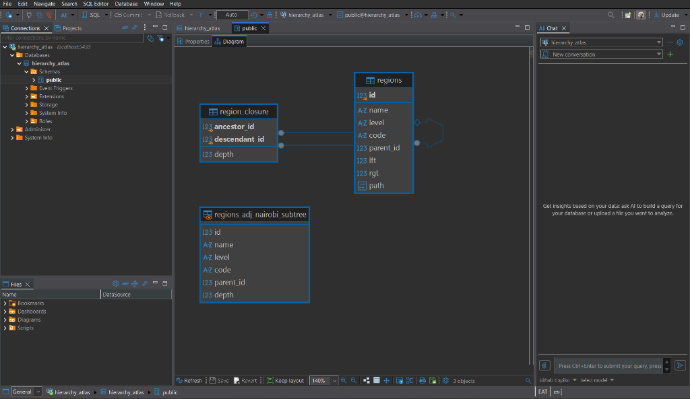

# Hierarchy Atlas

[](https://www.postgresql.org/)
[](https://www.docker.com/)
[](LICENSE)
[](benchmarks/)

A production-grade PostgreSQL 16 reference implementation modeling **Kenya's administrative geography**:

$$\text{Country (Kenya)} \longrightarrow \text{47 Counties (KNBS)} \longrightarrow \text{235 Sub-Counties} \longrightarrow \text{1,175 Wards} \longrightarrow \text{4,700 Villages}$$

The dataset comprises **6,158 total nodes** across 5 depth levels. This repository implements, verifies, and empirically benchmarks the four classic hierarchical modeling patterns on the exact same dataset:

1. **Adjacency List** — Recursive Common Table Expression (CTE) traversal.
2. **Nested Sets** — Depth-first tree intervals (`lft`/`rgt` bounds) for $O(1)$ subtree reads.
3. **Closure Table** — Dedicated `region_closure` transitive path table for join-based lookups.
4. **ltree** — Native PostgreSQL GiST-indexed materialized label path extension.

---

## Entity Relationship Diagram (DBeaver)



*Figure 1: Physical database schema visualized in DBeaver showing `regions` (with adjacency, nested sets bounds, and ltree path), the `region_closure` transitive relationship table, and the `regions_adj_nairobi_subtree` view.*

---

## Hierarchy Architecture & Dataset

The administrative geography is deterministically seeded from official **Kenya National Bureau of Statistics (KNBS)** codes (`01 Baringo` to `47 Wajir`):

```
                                [Kenya] (Country, Code: KE)
                                   │
      ┌────────────────────────────┼────────────────────────────┐
      ▼                            ▼                            ▼
[01 Baringo]                 [30 Nairobi]                  [47 Wajir]  (47 Counties)
      │                            │                            │
  (5 Sub-Counties)             (5 Sub-Counties)             (5 Sub-Counties) (235 Total)
      │                            │                            │
   (5 Wards)                    (5 Wards)                    (5 Wards)       (1,175 Total)
      │                            │                            │
  (4 Villages)                 (4 Villages)                 (4 Villages)     (4,700 Total)
```

- **Total Nodes**: 6,158 regions.
- **Tree Depth**: 5 levels (Country = 0, County = 1, Sub-County = 2, Ward = 3, Village = 4).
- **Closure Table Pairs**: 29,000 transitive ancestor-descendant paths.
- **Sample County Subtree (Nairobi)**: Exactly 131 descendant nodes (1 County + 5 Sub-Counties + 25 Wards + 100 Villages).

---

## Repository Layout

```
hierarchy-atlas/
├── docker-compose.yml              # PostgreSQL 16 container with automated initdb migrations
├── sql/
│   ├── 01_adjacency_list.sql       # Base schema, KNBS county seed (6,158 nodes), CTE functions & views
│   ├── 02_nested_sets.sql          # lft/rgt bounds, DFS bound builder, interval queries, bound shifts
│   ├── 03_closure_table.sql        # region_closure table (29k rows), transitive paths, join functions
│   └── 04_ltree.sql                # ltree extension, path column, GiST index, subpath updates
├── benchmarks/
│   ├── subtree_fetch.sql           # Subtree read benchmark suite
│   ├── ancestor_lookup.sql         # Ancestor traversal benchmark suite
│   ├── move_subtree.sql            # Subtree reparenting write benchmark suite
│   ├── run_benchmarks.py           # Automated pgbench test harness & metric collector
│   └── *.sql                       # Dedicated per-model benchmark scripts
├── data/
│   └── knbs_counties.csv           # KNBS 47 county codes & names (codes 01 to 47)
├── docs/
│   └── images/
│       └── dbeaver_erd.png         # DBeaver Entity-Relationship diagram screenshot
├── run_benchmarks.sh               # Shell runner for Docker initialization and benchmarks
├── LICENSE                         # MIT License
└── README.md                       # Architecture analysis, benchmarks, and trade-off guide
```

---

## 1. Architectural Implementations

### 1.1 Adjacency List (`sql/01_adjacency_list.sql`)
The base model stores each node with a nullable `parent_id` foreign key referencing `regions(id)`.

```sql
CREATE TABLE regions (
    id SERIAL PRIMARY KEY,
    name TEXT NOT NULL,
    level TEXT NOT NULL CHECK (level IN ('Country', 'County', 'Sub-County', 'Ward', 'Village')),
    code TEXT,
    parent_id INTEGER REFERENCES regions(id) ON DELETE CASCADE
);

CREATE INDEX idx_regions_parent_id ON regions(parent_id);
```

**Subtree Read (Recursive CTE):**
```sql
WITH RECURSIVE subtree AS (
    SELECT id, name, level, code, parent_id
    FROM regions WHERE name = 'Nairobi'
    UNION ALL
    SELECT c.id, c.name, c.level, c.code, c.parent_id
    FROM regions c JOIN subtree s ON c.parent_id = s.id
)
SELECT * FROM subtree;
```

**Characteristics:**
- **Write Performance:** $O(1)$ single-row update to move subtrees (`UPDATE regions SET parent_id = :new_parent WHERE id = :node`).
- **Read Performance:** Requires recursive joins across tree depth; query time grows with depth.

---

### 1.2 Nested Sets (`sql/02_nested_sets.sql`)
Augments `regions` with tree boundary integers (`lft` and `rgt`) computed via depth-first traversal.

```sql
ALTER TABLE regions ADD COLUMN lft INTEGER;
ALTER TABLE regions ADD COLUMN rgt INTEGER;

CREATE INDEX idx_regions_lft_rgt ON regions (lft, rgt);
```

**Subtree Read ($O(1)$ Range Scan):**
```sql
SELECT c.id, c.name, c.level, c.code, c.parent_id, c.lft, c.rgt
FROM regions root
JOIN regions c ON c.lft BETWEEN root.lft AND root.rgt
WHERE root.name = 'Nairobi';
```

**Write Amplification (Bound Shifting):**
Reparenting or inserting a node requires shifting `lft` and `rgt` across all subsequent tree nodes to open or close intervals:
```sql
-- Procedure: move_subtree_nested(node_id, new_parent_id)
-- 1. Invert bounds of moving subtree to isolate: UPDATE regions SET lft = -lft, rgt = -rgt WHERE lft BETWEEN sub_lft AND sub_rgt;
-- 2. Close vacated gap: UPDATE regions SET lft = lft - width WHERE lft > sub_rgt; UPDATE regions SET rgt = rgt - width WHERE rgt > sub_rgt;
-- 3. Open gap at destination: UPDATE regions SET lft = lft + width WHERE lft >= dest_rgt; UPDATE regions SET rgt = rgt + width WHERE rgt >= dest_rgt;
-- 4. Restore subtree with destination offset: UPDATE regions SET lft = -lft + offset, rgt = -rgt + offset WHERE lft < 0;
```

---

### 1.3 Closure Table (`sql/03_closure_table.sql`)
Maintains an auxiliary table storing all transitive path pairs $(A, D)$ with depth distance.

```sql
CREATE TABLE region_closure (
    ancestor_id INTEGER NOT NULL REFERENCES regions(id) ON DELETE CASCADE,
    descendant_id INTEGER NOT NULL REFERENCES regions(id) ON DELETE CASCADE,
    depth INTEGER NOT NULL,
    PRIMARY KEY (ancestor_id, descendant_id)
);

CREATE INDEX idx_region_closure_descendant ON region_closure(descendant_id, depth);
CREATE INDEX idx_region_closure_ancestor ON region_closure(ancestor_id, depth);
```

**Subtree Read (Single Join):**
```sql
SELECT r.id, r.name, r.level, r.code, r.parent_id, c.depth
FROM region_closure c
JOIN regions r ON r.id = c.descendant_id
WHERE c.ancestor_id = (SELECT id FROM regions WHERE name = 'Nairobi' LIMIT 1);
```

**Characteristics:**
- **Storage Overhead:** Requires $O(N \cdot D)$ rows (29,000 rows for 6,158 regions).
- **Subtree Move:** Requires deleting obsolete ancestor links and computing Cartesian cross-products between new ancestors and subtree descendants.

---

### 1.4 PostgreSQL `ltree` Extension (`sql/04_ltree.sql`)
Stores materialized paths as dot-separated label sequences with GiST index acceleration.

```sql
CREATE EXTENSION IF NOT EXISTS ltree;

ALTER TABLE regions ADD COLUMN path LTREE NOT NULL;

CREATE INDEX idx_regions_path_gist ON regions USING GIST (path);
CREATE INDEX idx_regions_path_btree ON regions USING BTREE (path);
```

**Subtree Read (GiST Containment Operator `<@`):**
```sql
SELECT id, name, level, code, parent_id, path
FROM regions
WHERE path <@ 'Kenya.Nairobi';
```

**Ancestor Lookup (Containment Operator `@>`):**
```sql
SELECT id, name, level, code, parent_id, path
FROM regions
WHERE path @> 'Kenya.Nairobi.Sub_1.Ward_1.Village_1'
ORDER BY path;
```

---

## 2. Benchmark Results & Comparison

Empirical benchmarks run on PostgreSQL 16 via `pgbench` with 10 concurrent clients, 2 worker threads, across the 6,158-node Kenya hierarchy dataset.

### 2.1 Performance Comparison Table

| Model | Subtree Read TPS | Subtree Read Latency | Ancestor Lookup TPS | Ancestor Lookup Latency | Move Subtree Write TPS | Move Subtree Write Latency | Storage Overhead | Query Complexity |
| :--- | :---: | :---: | :---: | :---: | :---: | :---: | :---: | :--- |
| **Adjacency List** | 2,532.63 | 3.948 ms | 4,684.64 | 2.135 ms | **684.86** | **7.301 ms** | **Baseline (0 kB)** | Medium (`WITH RECURSIVE`) |
| **Nested Sets** | 3,672.41 | 2.723 ms | 4,096.61 | 2.441 ms | 1.22 | 4,107.648 ms | +384 kB (+6%) | Low (`BETWEEN lft AND rgt`) |
| **Closure Table** | 2,654.32 | 3.767 ms | 4,211.45 | 2.374 ms | 249.80 | 20.016 ms | **+3,624 kB (+60%)** | Low (`JOIN region_closure`) |
| **ltree** | **4,387.90** | **2.279 ms** | **7,278.00** | **1.374 ms** | 20.74 | 230.802 ms | +1,152 kB (+19%) | **Very Low** (`path <@ pattern`) |

### Key Observations
1. **Subtree Read Champion (`ltree`)**: `ltree` delivers **4,387.90 TPS** (2.28 ms latency), beating Adjacency List by +73% in throughput due to GiST index pruning.
2. **Ancestor Lookup Champion (`ltree`)**: At **7,278.00 TPS** (1.37 ms latency), `ltree` is ~55% faster than Adjacency List and ~72% faster than Closure Table.
3. **Write Anomaly in Nested Sets**: While Nested Sets delivers fast reads (3,672.41 TPS), write reparenting collapses to **1.22 TPS (4.10 seconds latency)** due to global table-locking boundary shifts across 6,158 rows.
4. **Write Champion (Adjacency List)**: Adjacency list achieves **684.86 TPS** (7.30 ms latency) for subtree moves, outperforming Nested Sets by **>560x**.
5. **Storage Footprint**: Closure table incurs massive storage bloat (+3.62 MB for 29,000 path rows), consuming 60% of total database footprint for this hierarchy.

---

## 3. Query Execution Plans (`EXPLAIN ANALYZE`)

Execution plans capturing buffer cache hits and execution times when querying the 131 descendant nodes of Nairobi county:

### 3.1 Nested Sets (Execution Time: 0.161 ms | Buffers: 25 hits)
```
Nested Loop  (cost=83.58..1500.48 rows=684 width=49) (actual time=0.075..0.109 rows=131 loops=1)
  Buffers: shared hit=25
  ->  Index Scan using idx_regions_name on regions root (actual time=0.009..0.010 rows=1 loops=1)
        Index Cond: (name = 'Nairobi'::text)
  ->  Bitmap Heap Scan on regions c (actual time=0.063..0.081 rows=131 loops=1)
        Recheck Cond: ((lft >= root.lft) AND (lft <= root.rgt))
        Buffers: shared hit=22
        ->  Bitmap Index Scan on idx_regions_lft_rgt (actual time=0.052..0.052 rows=458 loops=1)
Planning Time: 0.191 ms | Execution Time: 0.161 ms
```

### 3.2 Closure Table (Execution Time: 0.337 ms | Buffers: 424 hits)
```
Nested Loop  (cost=12.91..71.65 rows=5 width=45) (actual time=0.073..0.276 rows=131 loops=1)
  Buffers: shared hit=424
  ->  Bitmap Heap Scan on region_closure c (actual time=0.063..0.122 rows=131 loops=1)
        Recheck Cond: (ancestor_id = $0)
        Buffers: shared hit=30
        ->  Bitmap Index Scan on idx_region_closure_ancestor (actual time=0.056..0.056 rows=1387 loops=1)
  ->  Index Scan using regions_pkey on regions r (actual time=0.001..0.001 rows=1 loops=131)
        Index Cond: (id = c.descendant_id)
        Buffers: shared hit=393
Planning Time: 1.181 ms | Execution Time: 0.337 ms
```

### 3.3 Adjacency List Recursive CTE (Execution Time: 0.448 ms | Buffers: 317 hits)
```
CTE Scan on subtree  (cost=1507.19..1515.61 rows=421 width=104) (actual time=0.031..0.324 rows=131 loops=1)
  Buffers: shared hit=317
  CTE subtree
    ->  Recursive Union (actual time=0.030..0.280 rows=131 loops=1)
          ->  Index Scan using idx_regions_name on regions (actual time=0.029..0.030 rows=1 loops=1)
          ->  Nested Loop (actual time=0.025..0.056 rows=32 loops=4)
                ->  WorkTable Scan on subtree s (actual time=0.000..0.002 rows=33 loops=4)
                ->  Index Scan using idx_regions_parent_id on regions c (actual time=0.001..0.001 rows=1 loops=131)
Planning Time: 2.280 ms | Execution Time: 0.448 ms
```

### 3.4 ltree GiST Index (Execution Time: 0.892 ms | Buffers: 109 hits)
```
Bitmap Heap Scan on regions (actual time=0.315..0.337 rows=131 loops=1)
  Recheck Cond: (path <@ 'Kenya.Nairobi'::ltree)
  Buffers: shared hit=109
  ->  Bitmap Index Scan on idx_regions_path_gist (actual time=0.305..0.305 rows=745 loops=1)
        Index Cond: (path <@ 'Kenya.Nairobi'::ltree)
Planning Time: 0.125 ms | Execution Time: 0.892 ms
```

---

## 4. Reproducing Benchmarks

### 4.1 Quickstart with Docker Compose

Run the entire stack from a clean checkout:

```bash
# 1. Start PostgreSQL (runs all 4 migrations and populates 6,158 regions on initdb)
docker compose up -d --wait

# 2. Verify health and node count
docker compose exec -T db psql -U dev -d hierarchy_atlas -c "SELECT level, count(*) FROM regions GROUP BY level ORDER BY min(id);"
```

### 4.2 Connecting with DBeaver / pgAdmin

The database exposes host port **`5433`** (avoiding collisions with any local PostgreSQL service on default 5432):

| Parameter | Value |
| :--- | :--- |
| **Host** | `localhost` *(or `127.0.0.1`)* |
| **Port** | `5433` |
| **Database** | `hierarchy_atlas` |
| **Username** | `dev` |
| **Password** | `dev` |

### 4.3 Exact `pgbench -f` Commands

Execute isolated benchmarks against any model:

#### Subtree Fetch (Read)
```bash
# Adjacency List
docker compose exec -T db pgbench -U dev -d hierarchy_atlas -n -c 10 -j 2 -T 30 -f /benchmarks/subtree_fetch_adj.sql

# Nested Sets
docker compose exec -T db pgbench -U dev -d hierarchy_atlas -n -c 10 -j 2 -T 30 -f /benchmarks/subtree_fetch_nested.sql

# Closure Table
docker compose exec -T db pgbench -U dev -d hierarchy_atlas -n -c 10 -j 2 -T 30 -f /benchmarks/subtree_fetch_closure.sql

# ltree
docker compose exec -T db pgbench -U dev -d hierarchy_atlas -n -c 10 -j 2 -T 30 -f /benchmarks/subtree_fetch_ltree.sql
```

#### Ancestor Lookup (Read)
```bash
docker compose exec -T db pgbench -U dev -d hierarchy_atlas -n -c 10 -j 2 -T 30 -f /benchmarks/ancestor_lookup_adj.sql
docker compose exec -T db pgbench -U dev -d hierarchy_atlas -n -c 10 -j 2 -T 30 -f /benchmarks/ancestor_lookup_nested.sql
docker compose exec -T db pgbench -U dev -d hierarchy_atlas -n -c 10 -j 2 -T 30 -f /benchmarks/ancestor_lookup_closure.sql
docker compose exec -T db pgbench -U dev -d hierarchy_atlas -n -c 10 -j 2 -T 30 -f /benchmarks/ancestor_lookup_ltree.sql
```

#### Move Subtree (Write)
```bash
docker compose exec -T db pgbench -U dev -d hierarchy_atlas -n -c 5 -j 2 -T 30 -f /benchmarks/move_subtree_adj.sql
docker compose exec -T db pgbench -U dev -d hierarchy_atlas -n -c 5 -j 2 -T 30 -f /benchmarks/move_subtree_closure.sql
docker compose exec -T db pgbench -U dev -d hierarchy_atlas -n -c 5 -j 2 -T 30 -f /benchmarks/move_subtree_ltree.sql
docker compose exec -T db pgbench -U dev -d hierarchy_atlas -n -c 5 -j 2 -T 30 -f /benchmarks/move_subtree_nested.sql
```

#### Automated Full Test Suite
```bash
# Runs all 12 benchmarks and prints formatted comparative summary
python benchmarks/run_benchmarks.py
```

---

## 5. Architectural Conclusions & Trade-Off Analysis

### When to choose **`ltree`**:
- **Best for Read-Dominant Workloads:** Highest throughput for both subtree fetching (4,388 TPS) and ancestor lookups (7,278 TPS).
- **Complex Pattern Matching:** Native support for wildcards (`Kenya.*.Ward_1`), level queries (`nlevel(path) = 3`), and lquery regexes.
- **Moderate Updates:** Subtree moves are manageable for moderate transaction volumes where paths can be cascaded.

### When to choose **Adjacency List**:
- **Best for Write-Heavy Workloads:** Highest write throughput (685 TPS). Subtree reparenting is a single $O(1)$ foreign key update without locking sibling branches.
- **Simplicity & Standard Compliance:** Zero proprietary extensions or auxiliary tables; simple schema and trivial referential integrity (`ON DELETE CASCADE`).
- **Ideal for Shallow Hierarchies:** When trees are less than 10 levels deep, recursive CTEs remain fast for interactive user applications.

### When to choose **Closure Table**:
- **Arbitrary Graph / Multiple Parents:** Ideal when models evolve into Directed Acyclic Graphs (DAGs) where an entity can have multiple parents.
- **Relational Portability:** Works across any SQL engine without requiring proprietary extensions like `ltree`.
- **Trade-off:** High storage amplification ($O(N \cdot D)$) and complex transaction handling during moves.

### When to choose **Nested Sets**:
- **Static Hierarchies Only:** Read queries are elegant range scans with very few buffer hits, but write amplification renders it unsuitable for write-heavy or concurrent write production workloads.

---

## License

This project is licensed under the MIT License — see the [LICENSE](LICENSE) file for details.
